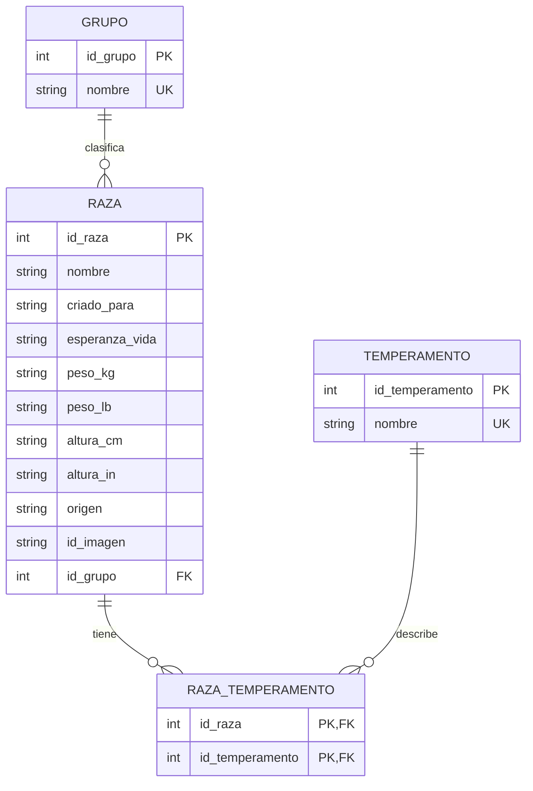

# Modelo relacional – Razas de Perros

Base de datos local **SQLite** manejada con **Room** (`razas_perros.db`).
Fuente de datos: **TheDogAPI** (`GET https://api.thedogapi.com/v1/breeds`).
Cada raza trae un grupo (`breed_group`) y una lista de temperamentos separados
por comas (`temperament`), por eso se normalizan en tablas propias (3FN).

## Diagrama



## Tablas

### GRUPO  (`GrupoEntity`)
| Campo | Tipo | Restricción | Origen en la API |
|---|---|---|---|
| id_grupo | INTEGER | PK, autoincremento | — |
| nombre | TEXT | NOT NULL, UNIQUE | `breed_group` |

### RAZA  (`RazaEntity`)
| Campo | Tipo | Restricción | Origen en la API |
|---|---|---|---|
| id_raza | INTEGER | PK | `id` |
| nombre | TEXT | NOT NULL | `name` |
| criado_para | TEXT | NULL | `bred_for` |
| esperanza_vida | TEXT | NULL | `life_span` |
| peso_kg | TEXT | NULL | `weight.metric` |
| peso_lb | TEXT | NULL | `weight.imperial` |
| altura_cm | TEXT | NULL | `height.metric` |
| altura_in | TEXT | NULL | `height.imperial` |
| origen | TEXT | NULL | `origin` |
| id_imagen | TEXT | NULL | `reference_image_id` |
| id_grupo | INTEGER | FK → GRUPO.id_grupo, NULL, ON DELETE SET NULL | `breed_group` |

### TEMPERAMENTO  (`TemperamentoEntity`)
| Campo | Tipo | Restricción | Origen en la API |
|---|---|---|---|
| id_temperamento | INTEGER | PK, autoincremento | — |
| nombre | TEXT | NOT NULL, UNIQUE | cada valor de `temperament` |

### RAZA_TEMPERAMENTO  (`RazaTemperamentoCrossRef`, tabla intermedia)
| Campo | Tipo | Restricción |
|---|---|---|
| id_raza | INTEGER | PK, FK → RAZA.id_raza, ON DELETE CASCADE |
| id_temperamento | INTEGER | PK, FK → TEMPERAMENTO.id_temperamento, ON DELETE CASCADE |

## Relaciones
- **GRUPO 1 : N RAZA** — un grupo (Hound, Toy, Working…) tiene muchas razas; una raza pertenece a un grupo (o a ninguno).
- **RAZA N : M TEMPERAMENTO** — una raza tiene varios temperamentos y un temperamento lo comparten varias razas; se resuelve con `RAZA_TEMPERAMENTO`.

## SQL equivalente (lo que Room genera)

```sql
CREATE TABLE grupo (
    id_grupo  INTEGER PRIMARY KEY AUTOINCREMENT NOT NULL,
    nombre    TEXT NOT NULL
);
CREATE UNIQUE INDEX index_grupo_nombre ON grupo(nombre);

CREATE TABLE raza (
    id_raza        INTEGER PRIMARY KEY NOT NULL,
    nombre         TEXT NOT NULL,
    criado_para    TEXT,
    esperanza_vida TEXT,
    peso_kg        TEXT,
    peso_lb        TEXT,
    altura_cm      TEXT,
    altura_in      TEXT,
    origen         TEXT,
    id_imagen      TEXT,
    id_grupo       INTEGER,
    FOREIGN KEY (id_grupo) REFERENCES grupo(id_grupo) ON DELETE SET NULL
);
CREATE INDEX index_raza_id_grupo ON raza(id_grupo);

CREATE TABLE temperamento (
    id_temperamento INTEGER PRIMARY KEY AUTOINCREMENT NOT NULL,
    nombre          TEXT NOT NULL
);
CREATE UNIQUE INDEX index_temperamento_nombre ON temperamento(nombre);

CREATE TABLE raza_temperamento (
    id_raza         INTEGER NOT NULL,
    id_temperamento INTEGER NOT NULL,
    PRIMARY KEY (id_raza, id_temperamento),
    FOREIGN KEY (id_raza) REFERENCES raza(id_raza) ON DELETE CASCADE,
    FOREIGN KEY (id_temperamento) REFERENCES temperamento(id_temperamento) ON DELETE CASCADE
);
CREATE INDEX index_raza_temperamento_id_temperamento ON raza_temperamento(id_temperamento);
```

## Implementación en el proyecto

| Archivo | Qué hace |
|---|---|
| `data/local/Entidades.kt` | Las 4 tablas (`@Entity`) + `RazaCompleta` (raza con su grupo y temperamentos) |
| `data/local/RazaDao.kt` | Consultas: listar razas, buscar por id, filtrar por grupo, insertar/actualizar |
| `data/local/RazasDatabase.kt` | `@Database` y la instancia única (`razas_perros.db`) |
| `data/local/RazaRepository.kt` | Descarga de la API → guarda en SQLite → la pantalla lee de SQLite (funciona sin internet) |
| `MainActivity.kt` | Usa `RazaRepository` en lugar de llamar a Retrofit directo |

Para ver la base de datos con la app corriendo: **View → Tool Windows → App Inspection → Database Inspector**.
